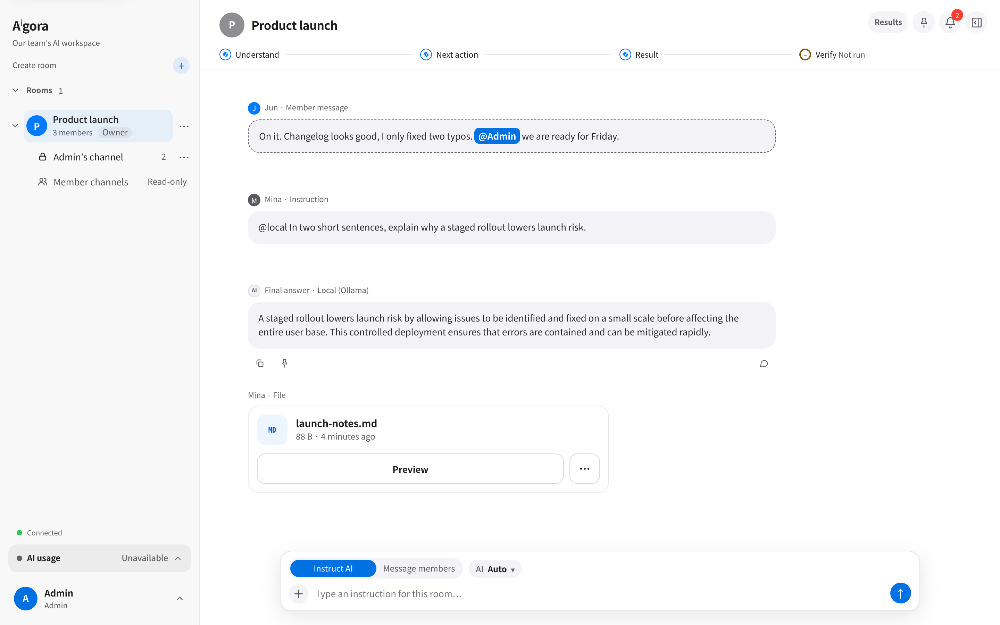
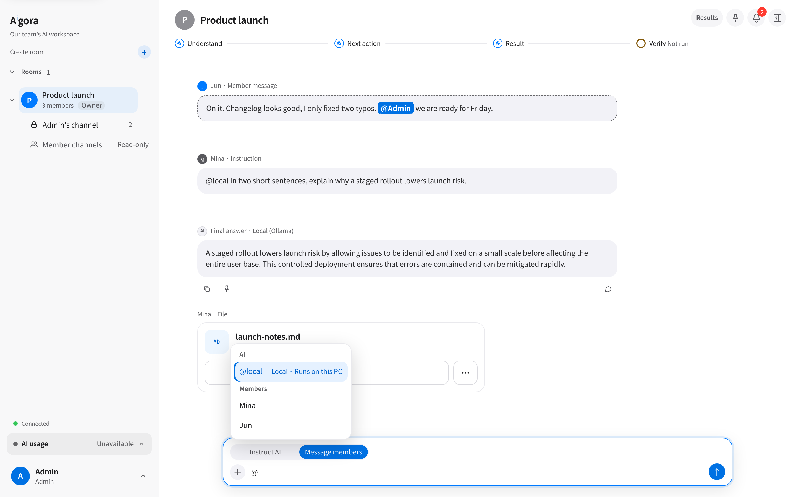
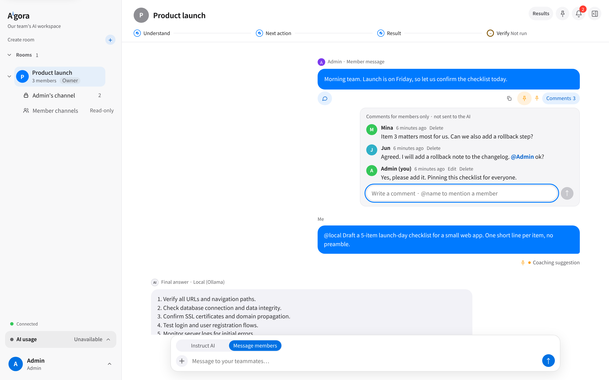
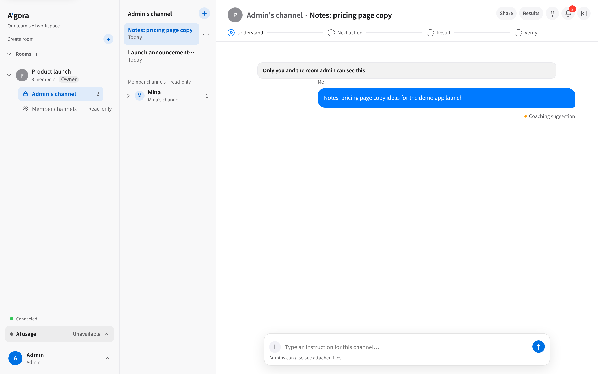
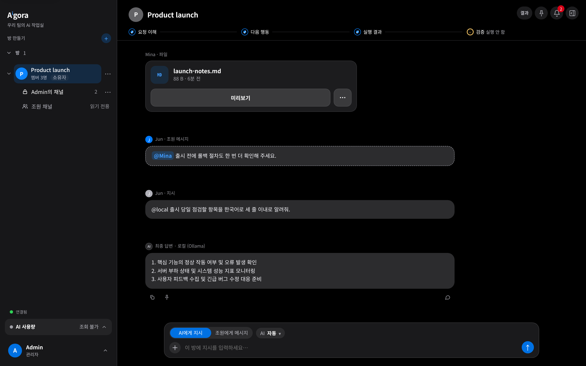
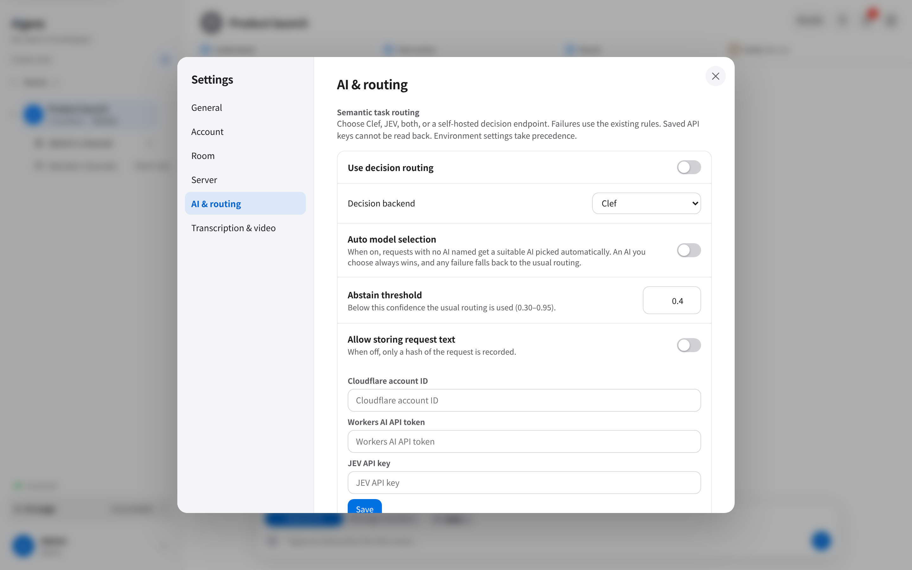
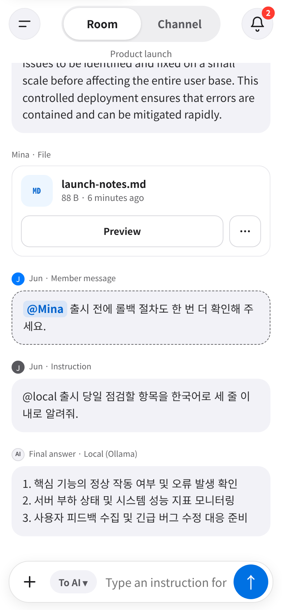

# Aigora

[한국어](README.ko.md) · [API setup](docs/setup-api.md) · [Local models](docs/local-models.md) · [Security](SECURITY.md) · [Privacy](PRIVACY.md)

Aⁱgora ("eye-gora") is a self-hosted collaborative AI workspace. People and AI agents work in browser-based rooms, share a feed and files, and keep personal work in private channels. Use explicit Anthropic/OpenAI API credentials, OpenAI-compatible model endpoints, or both. Independent project; no affiliation with AI providers.

Owner: gopuda11

## Built with AI

gopuda11 directs AI agents with separate planning, implementation and review roles, then owns integration and release decisions. Aigora extends Clay and Clagentic with collaboration, private channels, routing and media workflows. [Building with AI](docs/BUILDING-WITH-AI.md) records the process, concrete regressions, owner-measured development figures and verification limits.

## Screenshots

Captured from a local demo instance with fictional users and a local Ollama model (`gemma4:12b`) answering through `@local`.



| | |
|---|---|
|  |  |
| **@ picker** — address an AI agent or a teammate from the same composer. | **Member comments** — threads under any message stay between people and are not sent to the AI; pins keep decisions visible. |
|  |  |
| **Private channels** — personal sessions inside a room, visible only to the owner and the room admin. | **Korean / English, light / dark** — a local model answering in Korean. |
|  |  |
| **Decision routing** — optional Clef/JEV routing, auto model selection and abstain threshold, set by admins. | **Phone layout** — Room/Channel switch and a touch composer; installable as a PWA. |

## Features

### Collaboration

- Rooms with a shared chronological feed, human messages, AI answers, visible run progress and file cards; room creation, renaming, descriptions, invitations, membership roles, archive/restore and deletion controls.
- Private channels and sessions tied to their owner, folders/groups, rename/archive/restore/delete, personal conversation layouts and cross-vendor sessions. Room membership does not grant access to another person's private channel.
- Shared posts, comments/replies, reactions, pins, read state and jump-to-message links; member `@mentions`, an AI/member picker and highlighted mentions of you.
- Presence, typing/activity indicators, direct messages and per-project sticky notes in the console.
- Responsive desktop/phone navigation, installable PWA, reconnect recovery, cached views and drafts, scroll restoration and offline queued messages. Queued sends persist in the browser and are retried when connected; an offline browser cannot execute an agent.

### AI work

- Claude and Codex agents using API keys; streaming answers, tool/activity displays, Stop, tool permission/approval prompts, file results, diagnostic errors, context/token displays and session history.
- Pick an agent per message or use `@claude`, `@codex`, `@local` and configured endpoint aliases. Model/effort controls obey the server model policy; this version pins API agents to the models documented in [setup](docs/setup-api.md#models-and-cost).
- Clef routing decisions, TypeSafe System One/JEV decisions, an ensemble backend, automatic selection (opt-in), decision explanations/feed, abstention, fallback, outcome reporting and optional shadow comparisons. These optional decision services are separate from the execution provider.
- Orchestrated multi-step work with research, implementation and verification steps, expandable run logs, retry/cancel, artifact import and local/endpoint result verifiers; configured endpoint workers can perform bounded file work only when explicitly enabled and compatible with that protocol.
- Local OpenAI-compatible chat, model discovery, primary chat/code/manual choices, extra endpoints, aliases, health/status, context/output limits, reasoning controls, local title generation and single/cross verification. The primary local adapter is text chat without a tool loop.
- Prompt coaching and suggestions, reusable skills/catalog installation, Git-backed skills sources, project instruction discovery, MCP configuration/bridge and provider-supported plugins. Imported skills, plugins and instruction files are trusted code/content, not a security boundary.
- Scheduled prompts, run scheduling/concurrency, recurring loops with run history and stop/resume controls, Git worktrees and workspace snapshots. Availability depends on provider and host prerequisites.

### Files and media

- Uploads/attachments scoped to a room or channel, selecting files for a turn, result-file cards, previews/lightbox, downloads and file operations. Supported document text can be extracted for context; arbitrary binary files are not automatically understood.
- Console file browser, editor, diffs/Git views, project terminal and browser/MCP tools. These host features have their own authorization and are not automatically inside the agent sandbox.
- Optional ONLYOFFICE co-editing of DOCX/XLSX/PPTX, including new blank documents, save callbacks and theme-aware editor layouts; requires a separate Document Server and JWT configuration. HWP is download-only. See [Office co-editing](docs/office-coediting.md).
- Optional audio transcription through `/audio/transcriptions`, stored transcripts, status/retry and attachment authorization. Requires an API speech service or separately hosted compatible Whisper service.
- Video/lecture audio extraction and timestamped transcription; emphasis scoring, frame/scene selection, deduplicated thumbnails, transcript/frame context for subsequent AI understanding, duration/size limits and cancellation. Local LLM emphasis refinement is loopback-only; experimental pixel-based pen/laser detection is opt-in. This is not a universal vision model or a guarantee of accurate lecture notes.

### Personalization and administration

- English and Korean Aigora interface, light/dark/system mode; the console also offers named color themes, display/font preferences and accessibility/reduced-motion controls.
- Account username/display name/PIN/profile settings, session/logout controls, in-app bell notifications, approval alerts, optional web push and SMTP notifications.
- Admin settings for room/member permissions, approvals, routing, endpoint models, transcription, skills, projects, server defaults and diagnostics/audit. Only authorized administrators can save server credentials.
- CLI setup, project add/remove/list, daemon restart/shutdown, build/update diagnostics and optional OS-user separation. Feature visibility varies between the collaboration page (`/aigora/`) and the project console (`/`).

## Quick start

Use Node.js **22.15+** and npm. Linux x64 is required by the shipped agent-containment implementation. Contained turns additionally need `bwrap`, system Python 3, user/network namespaces and working `systemd-run --user`; unsupported hosts refuse contained turns.

```sh
git clone <public-repository-url>
cd Aigora
npm ci
export ANTHROPIC_API_KEY='<your-api-key>'
export OPENAI_API_KEY='<your-api-key>'
node bin/cli.js --host 127.0.0.1 --no-https --no-update
```

There is no frontend build step: the daemon serves the checked-in browser assets. Follow the terminal setup wizard, open the printed URL (default port **2633**), and use its setup code to create the administrator account. Add a project with `node bin/cli.js --add .`; create a room/invite members in the UI. The two agent keys are independent; configure only the provider you intend to use. A local-only setup can omit both keys.

Bind explicitly: the CLI otherwise defaults to **0.0.0.0**. Plain HTTP is appropriate only for a trusted loopback setup; use TLS for remote access. Browser dependencies/fonts currently load from CDNs, so installing the server alone does not make the UI fully offline.

For private-channel containment, explicitly set `privateExecution.claude` and `privateExecution.codex` to `true`. Room Claude/Codex turns are contained by default, private turns are **not**. Read [SECURITY.md](SECURITY.md) before inviting users. Missing keys produce `credential_unavailable`, not a login fallback.

## Documentation and checks

- [API configuration, storage, errors and costs](docs/setup-api.md)
- [Local chat, Qwen3, Whisper and external NPU/OpenVINO options](docs/local-models.md)
- [Security and sandbox limits](SECURITY.md), [self-hoster privacy](PRIVACY.md)
- [Fork provenance](FORK_NOTICE.md), [credits](CREDITS.md), [dependency license texts](THIRD-PARTY-NOTICES.md)

`npm test` runs the suite available in the checkout. `npm run check:public` checks the source; `scripts/export-public.sh --working-tree <empty-directory>` materializes uncommitted content and scans it without writing Git metadata. The ordinary export creates a fresh public history from committed HEAD; it never pushes. Keep export-review artifacts, dependencies and deployment data out of the published tree.

## License

Aigora is MIT-licensed. The Clay and Clagentic Console copyright notices are preserved in [LICENSE](LICENSE). Installed dependencies, model weights and optional external services retain their own licenses and provider terms.
